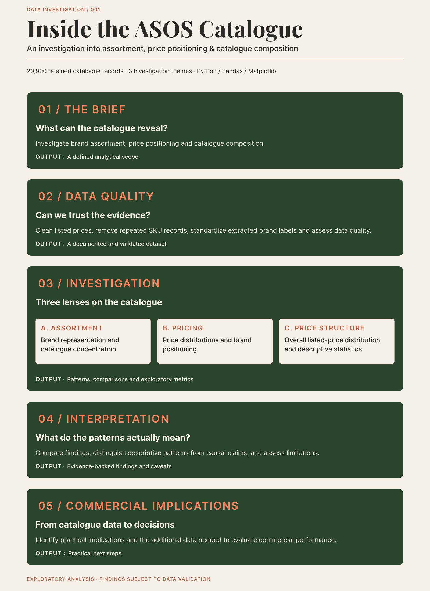
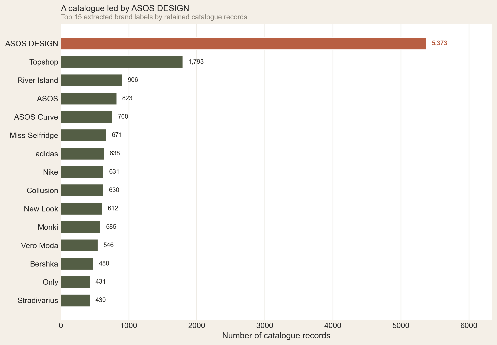
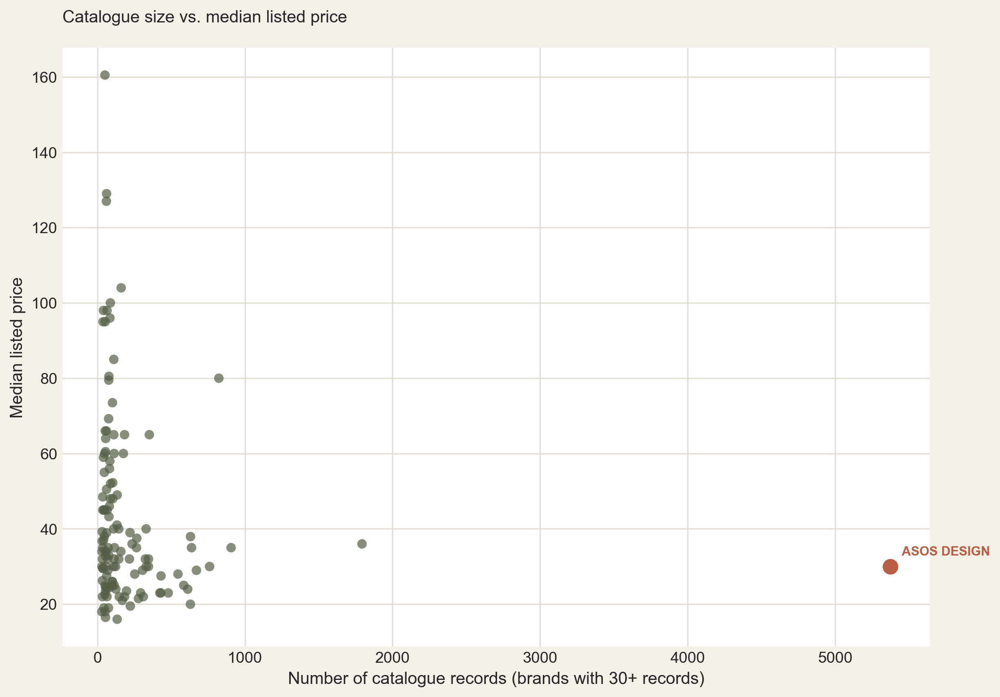
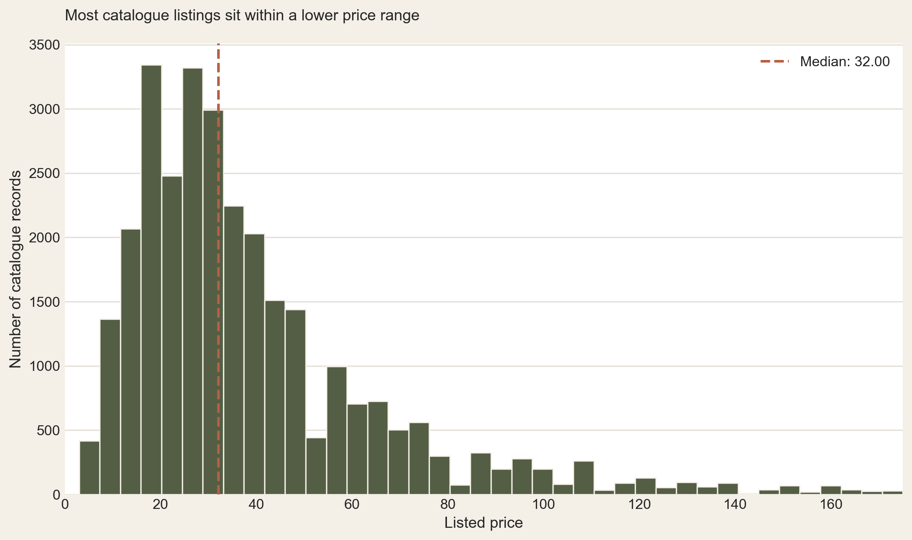

# Inside the ASOS Catalogue
### An investigation into assortment, price positioning & catalogue composition

**DATA INVESTIGATION / 001 · RETAIL ANALYTICS**

What can a fashion retailer's product catalogue reveal about its assortment structure, brand concentration and price positioning?

This project investigates the ASOS catalogue through exploratory retail analytics, examining how catalogue records are distributed across brands, how listed prices vary, and where the assortment is concentrated.

The investigation moves from data preparation to analytical findings, translating product-level data into a structured commercial perspective.

---

## The investigation framework
### From questions to analytical direction



The investigation was structured across five stages, from defining the analytical scope and assessing data quality to interpreting patterns and identifying commercial implications.

The framework guided three analytical themes:

- **Assortment:** Brand representation and catalogue concentration
- **Pricing:** Price distributions and brand positioning
- **Price structure:** Overall listed-price distribution and descriptive statistics

---

## Key findings

| Metric | Finding |
|:--|--:|
| Source records | 30,845 |
| Retained catalogue records | 29,990 |
| Brand extraction coverage | 98.1% |
| Top 10 labels' catalogue share | 42.8% |
| Largest label: ASOS DESIGN | 5,373 records |
| ASOS DESIGN catalogue share | 17.9% |
| Median listed price | 32.00 |
| Mean listed price | 40.73 |
| Records priced at 30 or below | 14,491 (48.3%) |

### 01 / Catalogue concentration

The top 10 labels account for **42.8% of retained catalogue records**, with ASOS DESIGN alone representing **17.9%**.

This indicates that catalogue representation is concentrated among a relatively small group of labels, providing a starting point for understanding the composition of the assortment.

### 02 / A broad listed-price distribution

The median listed price is **32.00**, compared with a mean of **40.73**.

Almost half of retained records (**48.3%**) are listed at 30.00 or below. The difference between the mean and median suggests that higher-priced records pull the average above the midpoint.

These figures describe the observed catalogue, not customer spending or realised selling prices.

### 03 / Price positioning varies across brands

Comparing median listed prices across brands with sufficient catalogue representation provides a view of relative price positioning within the assortment.

The comparison applies a minimum threshold of 30 records per brand, reducing the influence of labels with very limited representation.

Price differences are descriptive. They do not independently establish brand value, customer preferences or commercial performance.

---

## The analytical investigation
### From data to findings

### 01 / Catalogue concentration



**Investigation question:** Which labels occupy the largest share of the assortment, and how quickly does cumulative catalogue coverage build?

The analysis examines brand-level catalogue counts, individual catalogue shares and cumulative concentration.

The largest labels provide a view of how representation is distributed across the catalogue.

### 02 / Brand price positioning



**Investigation question:** How does median listed price vary across brands with sufficient catalogue representation?

Brand-level median prices provide a comparative view of listed-price positioning across the assortment.

The analysis uses a minimum threshold of 30 catalogue records per brand.

### 03 / Overall price distribution



**Investigation question:** Where do listed prices cluster, and how does the distribution extend beyond its median?

The analysis examines the overall distribution of numeric listed prices, using descriptive statistics to understand the catalogue's price structure.

---

## Methodology

The investigation followed a structured exploratory workflow.

**01 — Prepare the catalogue**

- Load and inspect the source dataset.
- Exclude records missing all core analytical fields: name, SKU, price and category.
- Remove repeated analytical records.
- Preserve original price wording for traceability.

**02 — Structure the data**

- Extract brand labels from product details using a curated list of 212 known brands.
- Match brand names using longest-first prefix matching.
- Retain unmatched records rather than forcing uncertain classifications.
- Parse numeric listed prices and classify their original wording.

**03 — Investigate assortment composition**

- Count catalogue records by brand.
- Calculate catalogue shares and cumulative concentration.
- Identify the largest labels and top 10 contribution.

**04 — Investigate price positioning**

- Compare median listed prices across brands.
- Apply a minimum brand representation threshold of 30 records.
- Examine the overall listed-price distribution.
- Compare descriptive statistics across price types.

**05 — Interpret and communicate**

- Translate analytical outputs into visual findings.
- Distinguish descriptive patterns from causal claims.
- Identify practical implications and evidence gaps.

---

## Data quality & preparation

### Dataset reconciliation

| Data preparation | Records |
|:--|--:|
| Source records | 30,845 |
| Blank records excluded | 18 |
| Repeated analytical records removed | 837 |
| **Retained catalogue records** | **29,990** |

Repeated analytical records were identified using:

`sku`, `name`, `size`, `category`, `price`, `color`, `description`

URLs and image fields were excluded from the deduplication key.

### Brand extraction

| Metric | Records |
|:--|--:|
| Curated brand reference list | 212 brands |
| Matched brand records | 29,419 |
| Unmatched brand records | 571 |
| Extraction coverage | 98.1% |

Brand extraction uses product-detail text and a curated matching approach. Coverage indicates successful extraction under this method, not independently verified brand accuracy.

### Listed-price preparation

| Price type | Records |
|:--|--:|
| Standard | 17,889 |
| Sale | 12,029 |
| Starting price | 72 |
| **Total** | **29,990** |

All non-empty price values were successfully parsed in the final analysis.

---

## What the analysis tells us

**What the catalogue can reveal**
- How catalogue representation is distributed across labels.
- How listed-price levels vary across the observed assortment.
- Where the catalogue is concentrated and how its prices are distributed.

**What the catalogue cannot establish**
- Which brands generate the most revenue or profit.
- Whether customers prefer particular brands or price points.
- Actual product availability, sell-through or inventory performance.
- Whether pricing differences cause differences in demand.

### Analytical limitations

- Catalogue records represent analysed listings, not necessarily unique styles, units sold or inventory quantities.
- *Starting price* may represent a lower-bound price for a product with multiple variants.
- *Sale* and *Standard* are classifications based on displayed wording, not independently verified promotional status.
- Discount depth is not calculated because reliable original/current price pairs are not established.
- Currency is not confirmed in this analysis; price figures are presented without a currency symbol.
- Brand extraction depends on the curated reference list and matching logic.

---

## Commercial implications & next steps

The catalogue provides a useful baseline for understanding assortment structure and listed-price positioning.

Potential follow-up investigations include:

- **Assortment strategy:** Evaluate whether catalogue representation aligns with commercial priorities.
- **Pricing strategy:** Compare listed prices with realised selling prices and promotional history.
- **Commercial performance:** Connect catalogue composition with sales, revenue and margin.
- **Inventory planning:** Incorporate inventory history and product availability data.

These are opportunities for further investigation, not conclusions established by the current dataset.

---

## Tools & skills

**Tools:** Python · Pandas · NumPy · Matplotlib · Jupyter Notebook · Figma

**Skills:** Exploratory Data Analysis · Data Cleaning · Data Quality · Data Visualisation · Retail Analytics · Business Storytelling

---

## Repository structure

```text
asos-catalogue-intelligence/
│
├── Inside_the_ASOS_Catalogue_Analysis.ipynb
├── products_asos.csv
├── visuals/
│   ├── analysis-process.png
│   ├── catalogue-concentration.png
│   ├── price-positioning.png
│   └── price-distribution.png
└── README.md
```

---

## Reproduce the analysis

1. Clone or download this repository.
2. Install the required Python libraries.
3. Open the notebook in Jupyter Notebook or JupyterLab.
4. Run the notebook cells in order.

Install dependencies:

```bash
pip install pandas numpy matplotlib jupyter
```

The source dataset is required to reproduce the analysis. The investigation framework and chart exports are provided in the `visuals/` directory.

---

## Closing perspective

A catalogue is more than a collection of products. Its composition and price structure offer a lens through which to investigate assortment strategy.

This investigation establishes a baseline: **where the catalogue is concentrated, how listed prices are distributed, and how price positioning differs across labels.**

The next step is to connect these patterns with sales and inventory data to evaluate whether catalogue structure translates into commercial performance.

---

*An Independent Exploratory retail analytics project.*
